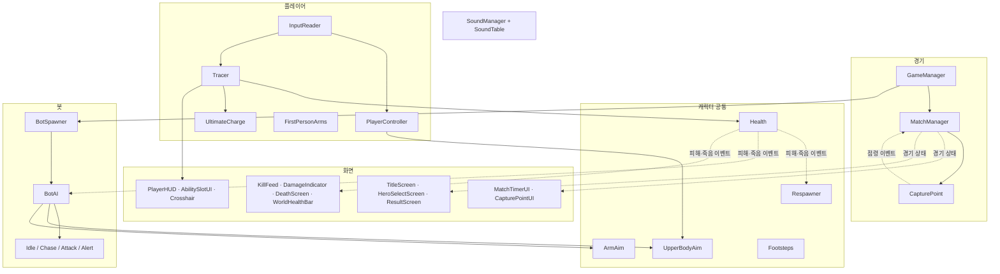
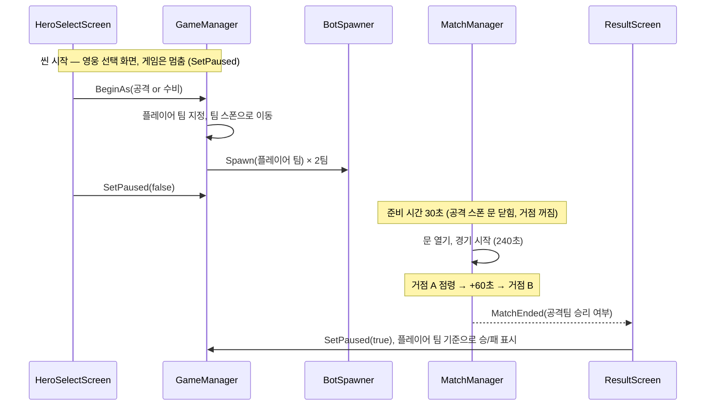
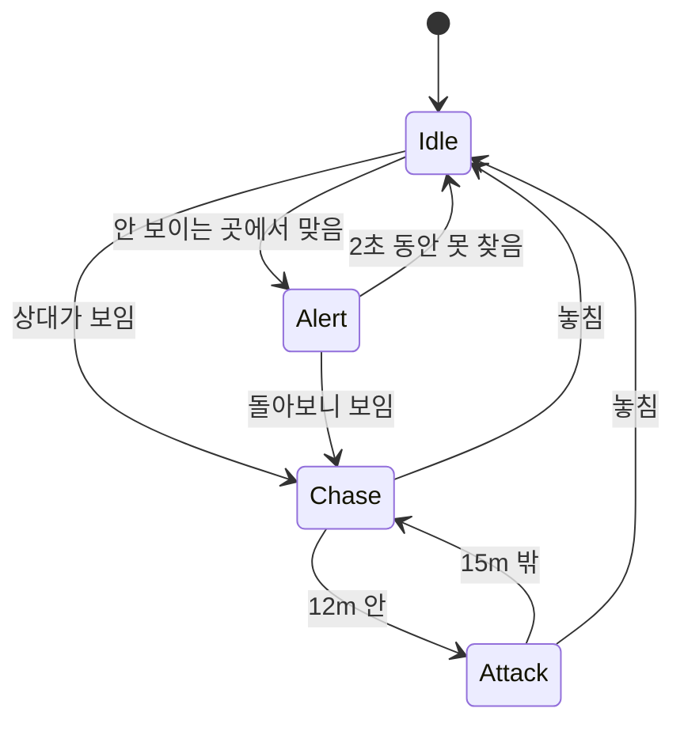

# 코드 구조

오버워치 2CP를 따라 만든 1인칭 슈팅 게임의 코드 구조. 스크립트는 전부 `Assets/Scripts/`에 있고, 에디터 전용 도구만 `Assets/Editor/`에 있다.

## 한눈에 보기

실선은 "직접 부른다", 점선은 "이벤트로 알린다"이다.

## 씬과 한 판의 흐름

| 씬 | 하는 일 |
|---|---|
| `Title` | 시작/종료 버튼 (`TitleScreen`) |
| `SampleScene` | 실제 경기. 영웅 선택 → 준비 시간 → 경기 → 결과가 모두 이 씬 안에서 일어난다 |

봇을 씬 시작이 아니라 팀을 고른 뒤에 만드는 이유는, 플레이어 팀이 정해져야 인원(플레이어 팀은 봇 4명)과 킬로그 이름(Ally / Enemy)을 정할 수 있어서다.

## 영역별 설명

### 경기

| 스크립트 | 역할 |
|---|---|
| `GameManager` | 씬에 하나. 다른 스크립트가 경기(`MatchManager`)와 피격 효과 풀(`ObjectPool`)을 꺼내 쓰는 곳. 팀 선택(`BeginAs`)과 일시정지(`SetPaused`)도 여기서 한다 |
| `MatchManager` | 경기 규칙: 준비 시간, 남은 시간, 연장전, 승패. 화면 표시는 하지 않는다 |
| `CapturePoint` | 거점 하나. 트리거 안의 양 팀 인원을 세서 점령 게이지, 체크포인트, 경합을 처리한다. 점령되면 `Captured` 이벤트를 보낸다 |
| `Team` | `Attack` / `Defend`. 팀은 레이어가 아니라 값이라 판마다 바꿀 수 있다 |

거점은 "점령됐다"는 사실만 알리고, 그게 승리인지는 `MatchManager`가 정한다. 그래서 거점을 3개로 늘려도 `CapturePoint`는 그대로다.

### 캐릭터 공통 (플레이어와 봇이 같이 쓴다)

| 스크립트 | 역할 |
|---|---|
| `Health` | 체력과 팀. `Damaged` / `Died` / `Revived` 이벤트, 누가 마지막으로 때렸는지(`LastAttacker`), 상대 팀인지(`IsHostileTo`). 켜진 모든 체력 목록(`Health.All`)과 누군가 죽었을 때의 전역 이벤트(`AnyKilled`)도 갖고 있다 |
| `Respawner` | 죽으면 몸을 숨기고 행동을 멈춘 뒤 10초 후 팀 스폰에서 되살린다. 캐릭터를 새로 만들지 않고 옮겨 써서 UI 연결이 유지된다 |
| `UpperBodyAim` | 조준 방향을 받아 상체는 바로, 하체는 뒤따라 돌린다. 조준을 마우스가 정하는지 AI가 정하는지는 모른다 |
| `ArmAim` | 팔을 뻗는다. 봇은 상체 정면으로, 1인칭 플레이어는 손을 카메라 앞 자리로(두 마디 IK) |
| `Footsteps` | 실제로 걸은 거리로 발소리를 낸다. 이동 방식(CharacterController / NavMeshAgent)과 상관없다 |

모델이 Generic 아바타라 Unity 기본 IK를 못 써서, 상체 비틀기와 팔은 `LateUpdate`에서 뼈를 직접 돌린다. 실행 순서는 애니메이션 → `UpperBodyAim` → `ArmAim`(`DefaultExecutionOrder(100)`)이다.

### 플레이어

| 스크립트 | 역할 |
|---|---|
| `InputReader` | 키 입력을 이동/시점 값과 능력 슬롯(`AbilitySlot`) 이벤트로 바꾼다. 꺼지면 입력이 멈춘다 |
| `PlayerController` | 이동, 점프, 시점, 1인칭 몸 숨기기. `PlayerController.Local`로 자신을 알리고, UI는 `WhenReady()`로 플레이어를 받는다 |
| `Tracer` | 트레이서의 능력: 사격, 재장전, 점멸, 역행, 펄스 폭탄, 근접. 슬롯 이벤트를 받아 능력으로 갈라 보낸다 |
| `UltimateCharge` | 궁극기 게이지. 적에게 준 피해와 시간으로 찬다(준비 시간 제외) |
| `PulseBomb` | 던지면 처음 닿은 곳에 붙고 잠시 뒤 범위 피해 |
| `FirstPersonArms` | 시작할 때 몸 메시에서 팔 뼈에 붙은 삼각형만 골라 팔 메시를 만든다. 1인칭에서 팔만 보이게 하려고 |

영웅은 캐릭터마다 클래스를 하나씩 둔다(`Tracer.cs`). 입력은 슬롯 단위라, 영웅이 바뀌어도 `InputReader`는 그대로고 슬롯에 무엇을 꽂을지만 영웅이 정한다.

### 봇 (아군·적 AI)

| 스크립트 | 역할 |
|---|---|
| `BotSpawner` | 팀마다 하나. 플레이어 팀이 정해지면 봇을 만들고 팀과 스폰 지점을 넣어준다 |
| `BotAI` | 상태 기계. 시야(원뿔 + 가림 검사), 천천히 도는 조준, 길찾기처럼 상태들이 같이 쓰는 기능을 갖고 있다 |
| `BotState` | 상태의 부모. `Enter` / `Tick` / `Exit` |
| `BotIdleState` | 거점 안을 돌아다니며 두리번거린다 |
| `BotChaseState` | 상대를 쳐다보며 다가간다. 목적지는 거점 안으로 묶는다 |
| `BotAttackState` | 사거리 안에서 쏜다. 거점 밖이면 거점으로 걸어가면서 쏜다 |
| `BotAlertState` | 안 보이는 곳에서 맞으면 때린 쪽을 돌아본다 |

같은 AI가 팀에 따라 공격도 수비도 한다. 갈 곳은 둘 다 "지금 노리는 거점"이고, 양 팀 모두 거점을 밟는 걸 최우선으로 한다(공격팀은 점령하려고, 수비팀은 경합으로 막으려고). 상대를 쫓는 중에는 전체를 다시 훑지 않고 지금 대상만 보이는지 확인한다.

### 화면 (UI)

| 스크립트 | 보여주는 것 |
|---|---|
| `PlayerHUD`, `AbilitySlotUI`, `Crosshair` | 체력, 탄약, 스킬 쿨타임, 궁극기, 조준선. 값을 스스로 찾지 않고 `Tracer`가 넣어준다 |
| `MatchTimerUI` | 위 가운데 타이머와 목표 문구(CAPTURE / DEFEND, SETUP, OVERTIME) |
| `CapturePointUI` | 거점 아이콘, 진행도, CONTESTED |
| `WorldHealthBar` | 머리 위 체력바. 아군은 늘 파랗게, 적은 맞을 때만 빨갛게 |
| `DamageIndicator` | 맞은 방향 표시와 붉은 깜빡임 |
| `KillFeed` | 오른쪽 위 킬로그와 ELIMINATED 문구 |
| `DeathScreen` | 죽었을 때 화면, 부활 카운트다운. 부활할 때까지 소리를 끈다 |
| `TitleScreen`, `HeroSelectScreen`, `ResultScreen` | 타이틀, 팀·영웅 선택, 결과 |

규칙과 표시를 나눈다: `MatchManager` ↔ `MatchTimerUI`, `CapturePoint` ↔ `CapturePointUI`, `Health` ↔ 여러 UI. 규칙 쪽은 UI를 모르고, UI가 상태를 읽거나 이벤트를 듣는다.

### 사운드

| 파일 | 역할 |
|---|---|
| `SoundId` | 소리 종류 enum. 문자열 대신 써서 오타가 컴파일 때 잡힌다 |
| `SoundTable` | ScriptableObject 데이터 테이블(`Assets/Resources/SoundTable.asset`). 소리마다 클립 여러 개, 볼륨, 피치 흔들림, 위치 소리 여부, 들리는 거리 |
| `SoundManager` | 테이블을 읽어 재생. 오디오 소스 32개를 미리 만들어 돌려 쓴다 |

부르는 쪽은 `SoundManager.Play(SoundId.Blink)` 또는 `SoundManager.Play(SoundId.BotFire, 위치)`만 안다. 볼륨 조절은 코드가 아니라 테이블에서 한다.

### 그 밖

| 스크립트 | 역할 |
|---|---|
| `ObjectPool`, `FireParticle` | 피격 효과를 미리 만들어 돌려 쓴다 |
| `KenneyFontTool` (에디터) | 메뉴 한 번으로 TMP 폰트 에셋을 만들고 모든 UI 글꼴을 바꾼다 |

## 설계 원칙

1. **알리는 쪽은 듣는 쪽을 모른다.** `Health`는 죽었다는 이벤트만 보내고, 리스폰·AI·킬로그·죽음 화면이 각자 듣는다. 새 반응을 추가해도 `Health`는 안 바뀐다.
2. **규칙과 표시를 나눈다.** 경기 규칙 코드에 UI 코드가 섞이지 않게 한다.
3. **값으로 다룰 수 있는 건 값으로.** 팀은 레이어가 아니라 `Team` 값, 소리 설정은 데이터 테이블.
4. **씬을 뒤지지 않는다.** 캐릭터가 스포너로 생성되므로 `FindObjectOfType` 대신 등록(`Health.All`, `PlayerController.Local`)을 쓴다.
5. **구조는 필요해진 시점에 나눈다.** 쓰는 곳이 하나일 때는 합쳐 두고, 둘이 되면 나눈다. 예: 상하체 회전은 적 AI도 필요해졌을 때 `UpperBodyAim`으로 뺐고, 영웅 공통 부모(`Hero`)는 두 번째 영웅을 만들 때 뺀다.

각 결정이 왜 그렇게 됐는지는 [devlog.md](devlog.md)의 "설계 판단"에 있다.
